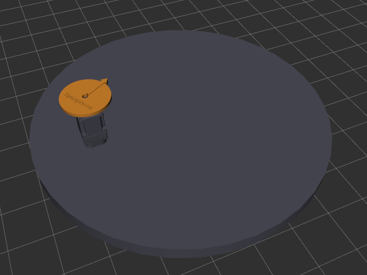
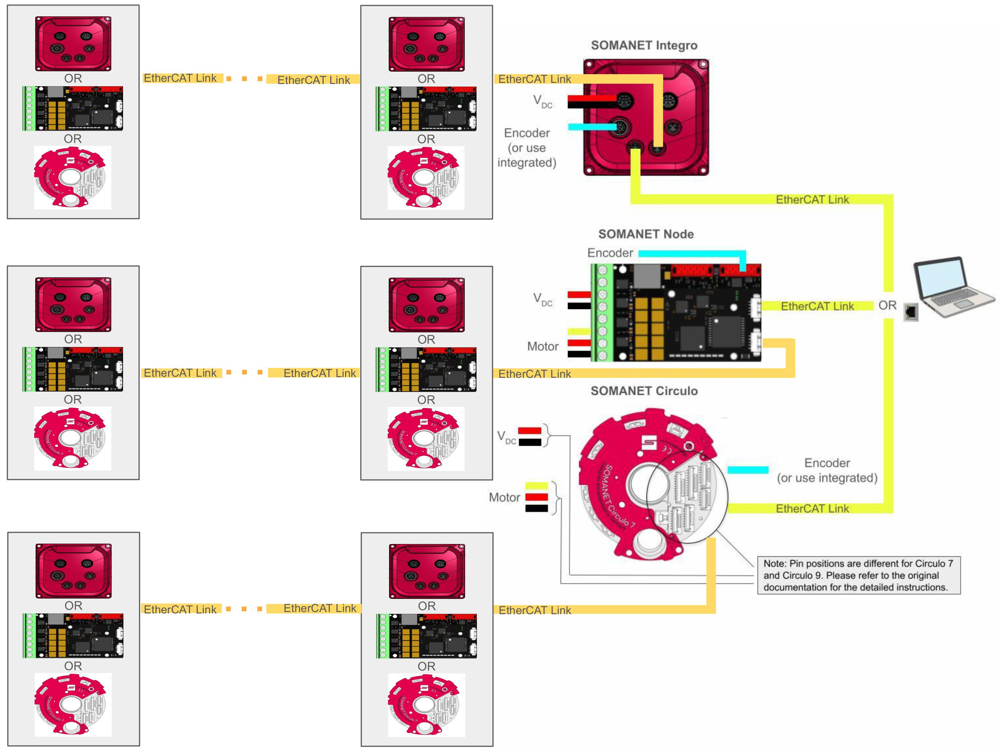

# Synapticon ros2_control

ros2_control hardware interface, controllers and examples for Synapticon SOMANET drives on EtherCAT.



## Table of contents

1. [Intention](#1-intention)
2. [Overview](#2-overview)
   - 2.1. [Hardware](#21-hardware)
   - 2.2. [Software](#22-software)
     - 2.2.1. [ROS 2](#221-ros-2)
     - 2.2.2. [This package](#222-this-package)
     - 2.2.3. [Access to the network interface](#223-access-to-the-network-interface)
     - 2.2.4. [Try it without hardware](#224-try-it-without-hardware)
   - 2.3. [Packages](#23-packages)
3. [Prepare a drive](#3-prepare-a-drive)
4. [Test your drive](#4-test-your-drive)
5. [Describe your robot](#5-describe-your-robot)
6. [Run on hardware](#6-run-on-hardware)
7. [Impedance and the effort command](#7-impedance-and-the-effort-command)
8. [Drive actions and faults](#8-drive-actions-and-faults)
9. [Interfaces](#9-interfaces)
10. [Transmissions](#10-transmissions)
11. [Documentation](#11-documentation)
12. [Disclaimer](#12-disclaimer)
13. [License](#13-license)

## 1. Intention

This repository shows how to run Synapticon drives (SOMANET Node, SOMANET Circulo and SOMANET Integro) with ROS 2 and
ros2_control.
It takes you from the installation to a joint that follows your commands, without hardware at first and then on
real drives.

One hardware interface serves every mode and any number of drives.
Below it, a hardware abstraction layer (HAL) talks to the drives: the EtherCAT HAL for real drives, or a mock for a
test without hardware.
This HAL sits below the ros2_control hardware interface, which ros2_control itself sometimes also calls a HAL.

| | Supported |
|---|---|
| ROS 2 | Jazzy |
| Drives | SOMANET drives with firmware 5.6.11 or newer, tested on a Circulo Safe Motion |
| Modes | Impedance (-6), cyclic synchronous position CSP (8) and velocity CSV (9). Torque control is impedance with stiffness and damping at 0 ([details](#7-impedance-and-the-effort-command)) |
| EtherCAT | The SOEM master library in user space, built with this repository |

## 2. Overview

### 2.1. Hardware

Configure the drives with [OBLAC Drives](https://www.synapticon.com/en/products/oblac-drives) before the first use.
Detailed instructions and wiring diagrams for all the devices are in the
[Synapticon documentation](https://www.synapticon.com/en/support/dokumentation).
The drives can be daisy chained in any order, as the figure shows.
A drive with only one EtherCAT port, like the ACTILINK-S with a single connector, must be the last on the chain.



### 2.2. Software

You need Ubuntu 24.04 with ROS 2 Jazzy, and this repository built in a colcon workspace.

#### 2.2.1. ROS 2

Install ROS 2 Jazzy as the [ROS 2 documentation](https://docs.ros.org/en/jazzy/Installation/Ubuntu-Install-Debs.html)
describes. In short:

```bash
sudo apt update && sudo apt install -y software-properties-common curl
sudo add-apt-repository universe
sudo curl -sSL https://raw.githubusercontent.com/ros/rosdistro/master/ros.key -o /usr/share/keyrings/ros-archive-keyring.gpg
echo "deb [arch=$(dpkg --print-architecture) signed-by=/usr/share/keyrings/ros-archive-keyring.gpg] http://packages.ros.org/ros2/ubuntu $(. /etc/os-release && echo $UBUNTU_CODENAME) main" | sudo tee /etc/apt/sources.list.d/ros2.list > /dev/null
sudo apt update && sudo apt install -y ros-jazzy-desktop ros-dev-tools
```

Then load ROS 2 in every new terminal, for example from the end of your `~/.bashrc`:

```bash
source /opt/ros/jazzy/setup.bash
```

To check the installation, run `ros2 run demo_nodes_cpp talker` in one terminal and `ros2 run demo_nodes_py listener`
in another. The listener prints what the talker says.

#### 2.2.2. This package

Use ROS 2 Jazzy on Ubuntu 24.04 and a colcon workspace.
The build needs no EtherCAT master installed: the SOEM library comes with this repository.

```bash
source /opt/ros/jazzy/setup.bash
mkdir -p ~/ws/src && cd ~/ws/src
git clone git@github.com:synapticon/synapticon_ros2_control.git
cd ~/ws
vcs import src < src/synapticon_ros2_control/synapticon_ros2_control.repos
rosdep install --from-paths src --ignore-src -r -y
colcon build --symlink-install --cmake-args -DCMAKE_BUILD_TYPE=Release
source install/setup.bash
```

Always pass an optimised build type.
The packages of this repository default to Release, but other packages in the workspace may build unoptimised code
into the real-time loop.
To run the tests, see [doc/Testing.md](synapticon_ros2_control/doc/Testing.md).
For build details, formatting and conventions, see [CONTRIBUTING.md](CONTRIBUTING.md).

The released binary packages and the images on `ghcr.io/synapticon/synapticon_ros2_control` are version 0.2.x,
built from the `jazzy` branch with a single package `synapticon_ros2_control`.
They do not contain the packages described here. For them, use the README on that branch.

#### 2.2.3. Access to the network interface

The SOEM HAL sends and receives Ethernet frames on the network interface of the drives, for example `eth0`.
Linux allows that only to a process with the capability `CAP_NET_RAW`.
Start everything that talks to real drives from a shell that has it, without running the stack as root:

```bash
"$(ros2 pkg prefix synapticon_ethercat_soem)/lib/synapticon_ethercat_soem/net_raw_shell.sh" --interface <interface>
source /opt/ros/jazzy/setup.bash && source install/setup.bash   # sudo resets the environment
```

`ip -br link` lists the interfaces: the drive's cable goes into a wired one, usually named `eno*`, `enp*` or `eth*`.
[synapticon_ethercat_soem](synapticon_ethercat_soem/README.md) explains the capability and how to give it to a service.
Only one EtherCAT master may use a network interface at a time.

To check that the drive answers, read it for a few seconds. This never powers it:

```bash
ros2 run synapticon_hardware drive_check read --network-interface <interface>
```

#### 2.2.4. Try it without hardware

```bash
ros2 launch synapticon_bringup example_synapticon.launch.py hal:=mock
```

In a second terminal, command the joint and read it back:

```bash
ros2 topic pub --once /forward_position_controller/commands std_msgs/msg/Float64MultiArray "{data: [0.75]}"
ros2 topic echo --once /joint_states --field position
```

The mock echoes the command as state, so the answer is `[0.75]`.

### 2.3. Packages

| Package | What it contains |
|---|---|
| `synapticon_hardware` | `SynapticonSystemInterface` (the hardware interface), the HAL interface `SynapticonHalI`, the CiA 402 helpers, the code the EtherCAT HALs share, the slave_config generator, `MockHal` |
| `synapticon_ethercat_soem` | `EthercatSoemHal`, the EtherCAT HAL through the SOEM library: the capability script, the hardware tests |
| `soem_source` | The SOEM EtherCAT master library, vendored unmodified |
| `synapticon_controllers` | `DriveController` (drive states and actions, fault reaction), `MotorCommandController` (impedance commands), `EthercatBusMonitorController` (bus health) |
| `synapticon_bringup` | The example launch file, robot definitions and controller configurations |
| `synapticon_description` | The example URDF and its xacro macros, with the motor and flywheel meshes |
| `synapticon_ros2_control` | The metapackage, with the documentation in `doc` |

```text
controllers
    |
SynapticonSystemInterface   ros2_control hardware interface, the same for every mode
    |
SynapticonHalI              hal: ethercat_soem | mock | mock_cia402
    |                \
EthercatSoemHal     MockHal (no bus, commands echo back as state)
    |               MockCia402Hal (simulated CiA 402 drives)
SOEM library
    |
EtherCAT bus
```

[doc/Design.md](synapticon_ros2_control/doc/Design.md) explains the layers and the rules behind them.

## 3. Prepare a drive

Do these steps once per drive before the first run on hardware.

### 3.1. Check the firmware

The stack needs firmware 5.6.11 or newer.
Bring-up refuses a joint in impedance mode on older firmware, or when it cannot read the version, and warns for the
other modes.
Bring-up reads the version and names it in the log when it is too old.
Update it with OBLAC Drives.

### 3.2. Generate a slave_config

Every drive needs a slave_config: a YAML file that says which values the drive exchanges every cycle (the PDO map)
and which settings it gets at start-up (the SDO list).
Both depend on the drive model and its firmware.
So make one for your drive. The bundled `example_somanet_circulo_safe_motion.yaml` fits only the drive it was made for.

The generator reads the drive's ESI file, the XML description that Synapticon publishes per firmware.
Download it from the [Synapticon downloads](https://doc.synapticon.com/circulo/technical_specs/downloads_circulo.html)
(section "Device descriptions"), for example `SOMANET_CiA_402_v5.6.11.xml`, and name your drive's product code and
revision:

```bash
ros2 run synapticon_hardware esi_to_slave_config.py --esi SOMANET_CiA_402_v5.6.11.xml \
  --product <product code> --revision <revision number> --out my_drive.yaml
```

If you pick the wrong ones, bring-up tells you the product code of the drive it found.

One file serves CSP and impedance mode, with the impedance gains in the map.
Its `sdo:` block writes a few settings at every bring-up. Check each one for your drive, the comments explain them.
A setting whose unit depends on the drive goes into the `sdo_si:` block instead, in SI units: bring-up converts it
with the units it reads from the drive.
With many drives on one bus, `--csp-only` gives a smaller map without the impedance objects, which leaves more room on
the bus.

### 3.3. Commission the drive for impedance

Only impedance mode needs this step. CSP and CSV work without it.
Synapticon still calls impedance mode beta.

| Setting | Where | Why |
|---|---|---|
| Torque sensor type | 0x2150:1 = 1 (Analog Input), stored | The torque loop needs it. Type 0 (None), set by every firmware flash, faults with 0x6320 on enable. Bring-up refuses it. |
| Analog coefficients | 0 without a physical sensor | The drive then works with the motor torque. |
| Torque limit | `max_joint_torque` in the robot definition, streamed to 0x2054 | Clamps the impedance output. At 0 the joint is powered but limp, and bring-up warns. |
| Gear ratio | 0x6091 | |
| Encoders | motor side for commutation and velocity, output side for position | |

Synapticon recommends type 1 (Analog Input). Write 1 to 0x2150:1, for example with OBLAC Drives, and store it on the
drive.
A drive without a physical torque sensor keeps its analog coefficients at 0, and then works with the motor torque.

Three more settings on the drive must be right: the gear ratio in 0x6091, the encoder on the motor side for
commutation and velocity, and the encoder on the output side for position.
Synapticon still calls impedance mode beta.

Finally, the torque limit. The drive clamps the output of the impedance law to MaxJointTorque (0x2054).
If 0 is stored there, the joint has power but no torque, and bring-up warns about it.
Store a limit on the drive, or set `max_joint_torque` in the robot definition.

### 3.4. Check the quick stop setting

What a quick stop does depends on the drive's quick stop option code (0x605A).
The bundled configuration sets 6: brake, then stay powered and hold.
See [doc/QuickStop.md](synapticon_ros2_control/doc/QuickStop.md) for the options and what bring-up checks.

## 4. Test your drive

Check the drive on its own before you run the ros2_control stack, and whenever you change its slave_config.
Every test below except `read` energises the drive and moves it: clear the joint, keep it free to turn about one
output revolution, and keep a hand near the power or the e-stop.
The tests address the drive at alias 0, ring position 0.
For a drive elsewhere on the bus, give `drive_check` the option `--ring-position N`.
For the automated tests, describe your bench in a robot definition file, see
[Your own bench](synapticon_ros2_control/doc/Testing.md#your-own-bench).

The tests take your drive's slave_config (step 2 above).
Without one, they use the bundled example, which fits only the Circulo Safe Motion it was generated for.
Bring-up refuses it on another drive model.

Run the tests in the shell of [Access to the network interface](#223-access-to-the-network-interface), with the stack stopped.

### 4.1. Run the tests

```bash
CFG=/path/to/my_drive.yaml
IF=eth0   # the network interface of the drive
ros2 run synapticon_hardware drive_check read --config "$CFG" --network-interface "$IF"   # bus up, state printed, never energises
ros2 run synapticon_hardware drive_check move --config "$CFG" --network-interface "$IF"   # moves the joint 30 deg back and forth
```

Then run every automated hardware test in one go, about 7 minutes:

```bash
SYNAPTICON_HIL_SLAVE_CONFIG="$CFG" ros2 run synapticon_bringup run_hil_tests.py --network-interface "$IF"
```

The summary at the end shows PASS or FAIL for each step.
The impedance steps need the drive commissioned for impedance (step 3 above).
With several drives on the bus, add `--robot <robot>` (for example `2dof` or `28dof`): the run then covers what needs
several drives, such as drive actions, motion and the fault reaction across joints.
[doc/Testing.md](synapticon_ros2_control/doc/Testing.md) describes each test, what to expect, the settings and the tests without hardware.

## 5. Describe your robot

A robot definition is a YAML file with the bus settings and one entry per drive.
For a first run you need none of your own: the examples come with definitions for 1, 2 and 28 joints and for the
geared robot (`synapticon_bringup/config/example_<robot>.yaml`, chosen with `robot:=`).
This section explains what such a file holds.

The URDF only names the file, in its `<hardware>` parameter `robot_config`.
The example xacro builds the URDF from the same file, and the EtherCAT HAL reads each drive's settings from it by
joint name.
For one drive it looks like this:

```yaml
bus:
  network_interface: eth0   # where the drives are wired
  control_frequency: 1000   # Hz, the same as update_rate of the controller manager
  readiness_timeout_s: 25.0 # how long bring-up waits for every drive to send valid data

joints:
  - name: joint_1
    position: 0             # the drive's place on the bus (ring position)
    alias: 0                # only 0 works: drives are found by their ring position
    slave_config: ""        # empty: the launch argument slave_config
```

Every joint with a drive needs an entry. More settings are optional:

- `energize: false` keeps a drive unpowered: it is set up and read, and requests to enable it are refused.
  This helps with a broken drive that is still on the bus.
- `invert: true` flips position, velocity and effort, for a drive mounted the other way round.
  Turning the joint axis in the URDF is the cleaner fix.
- `mode_of_operation` sets this joint's mode, where `impedance` sets it for all.
  CSV (9) needs the `velocity` command, which `impedance:=true` declares.
- `stiffness`, `damping` and `max_joint_torque` override `command_defaults` for this joint.

`command_defaults` decide what a drive gets where a command leaves a value out, for example a `MotorCommand` with empty
`stiffness` and `damping`, or the hold at activation.
Each such value gets the joint's default, never a value from an earlier command, which may have been meant for
something else.
With `keep_last_given: true`, a missing value repeats the joint's last given one instead, starting from the default
at every activation.
Every impedance joint that may be powered needs all three values, from here or from its own entry.
Without them bring-up stops, because the drive would run on whatever it stored last.
A value of 0 is allowed, with a warning.
Bring-up logs what each drive held and what it starts with.

A `<param>` in the URDF itself wins over the file.
The `<hardware>` parameters `default_slave_config` and `mode_of_operation` count for the joints whose entry does not
set them.

One rule matters a lot: keep `control_frequency` and the `update_rate` of the controller manager equal, and change them
together.
The frequency sets the drives' clock (the EtherCAT distributed clock), but the frames go out from the controller
manager's loop.
Nothing ties the two together, so if they differ, the clock drifts.

For another number of joints, let the generator write a robot definition and the matching controller configuration:

```bash
python3 synapticon_bringup/scripts/generate_example_robot.py --joints 5
python3 synapticon_bringup/scripts/generate_example_robot.py --joints 3 --robot gantry --names x_axis,y_axis,z_axis
```

Rebuild the package, then launch with `robot:=5dof` or `robot:=gantry`.
The example URDF is only there for RViz: every joint is a motor with a flywheel, on a ring around a hub.
A real robot brings its own URDF and launch file.

## 6. Run on hardware

Keep the joints free to move, and launch from the shell of [Access to the network interface](#223-access-to-the-network-interface).
After the launch, the drives are not energised. Energising is always a separate, explicit step.

### 6.1. Position control (CSP)

```bash
ros2 launch synapticon_bringup example_synapticon.launch.py robot:=2dof slave_config:=/path/to/my_drive.yaml \
  network_interface:=<interface>
```

Energise the drives, then command a position in rad, one value per joint in the order of the robot definition:

```bash
ros2 service call /drive_controller/set_drive_action synapticon_control_msgs/srv/SetDriveAction "{action: enable, dof_names: []}"
ros2 topic pub --once /forward_position_controller/commands std_msgs/msg/Float64MultiArray "{data: [0.5, 0.0]}"
ros2 topic echo --once /joint_states --field position   # close to [0.5, 0.0] once the move is done
```

The drive follows the first target it receives after the enable.
Make sure the command controller streams a target near the current position before you enable.

### 6.2. Impedance

```bash
ros2 launch synapticon_bringup example_synapticon.launch.py robot:=2dof impedance:=true \
  slave_config:=/path/to/my_drive.yaml network_interface:=<interface>
ros2 service call /drive_controller/set_drive_action synapticon_control_msgs/srv/SetDriveAction "{action: enable, dof_names: []}"
ros2 topic pub --once /motor_command_controller/commands synapticon_control_msgs/msg/MotorCommand \
  "{name: [joint_2], position: [-0.3], velocity: [0.0], torque_feedforward: [0.0], stiffness: [8.0], damping: [0.2]}"
```

This moves `joint_2` only. A joint that the message does not name holds where it is.
`position`, `velocity` and `torque_feedforward` need one value per name.
`stiffness` and `damping` may be empty. Then the joints get the `command_defaults` of the robot definition.

### 6.3. Launch arguments

Which robot runs:

| Argument | Default | Meaning |
|---|---|---|
| `robot` | `1dof` | picks `config/example_<robot>.yaml` and its `_controllers.yaml` |
| `robot_config`, `controllers_file` | from `robot` | a robot definition and controller configuration of your own |
| `disable_transmissions` | `''` | `true` runs the robot without its transmissions, see [Transmissions](#10-transmissions) |

How the drives are reached, and how they are controlled:

| Argument | Default | Meaning |
|---|---|---|
| `hal` | `ethercat_soem` | real drives; `mock` for none, `mock_cia402` for simulated ones that need an enable to move |
| `network_interface` | `''` | the drives' network interface; empty takes the robot definition's |
| `slave_config` | the bundled example | for every joint that names none in the robot definition |
| `impedance` | `false` | `true`: impedance mode (-6), its commands, and `motor_command_controller` |
| `command_controller` | from the mode | the controller that takes the joint commands |
| `launch_rviz` | `true` | shows the robot in RViz |

## 7. Impedance and the effort command

In impedance mode the drive runs the impedance law itself.
The controllers only send its terms:

```text
tau_demand = clamp( K * (q_target - q) + D * (dq_target - dq) + tau_offset,  +/- MaxJointTorque )
```

| Term | Object | Command interface | `MotorCommand` field |
|---|---|---|---|
| K, stiffness | 0x2060:1 | `stiffness` | `stiffness` |
| D, damping | 0x2060:2 | `damping` | `damping` |
| q_target | 0x607A | `position` | `position` |
| dq_target | 0x60FF | `velocity` | `velocity` |
| tau_offset | 0x2053 | `effort` | `torque_feedforward` |
| MaxJointTorque | 0x2054 | `max_joint_torque` | |

`q` and `dq` are the measured position and velocity.
The drive's joint torque controller then tracks `tau_demand` against the torque sensor.
The drive reports `tau_demand` in 0x2052, which the state interface `joint_torque_demand` carries.

So `effort` is the feedforward term of the law, in Nm on the joint (output) side, and not a target torque.
The hardware converts it to the mNm of 0x2053.
**With stiffness and damping at 0, the spring and the damper vanish, and `effort` is simply the joint torque.**
That is the torque control of this package.
The `effort` state is another torque: the drive's measured motor torque (0x6077), given on the shaft of the position
encoder, that is times the gear ratio (0x6091) the drive applies.

0x2053 is not the CiA 402 torque offset 0x60B2, which acts on the motor side.
This package does not use 0x60B2.
Synapticon's [impedance controller page](https://doc.synapticon.com/circulo_safe_motion/sw5.6/motion_control/operation_modes/impedance_controller.htm)
shows the law as a block diagram.

## 8. Drive actions and faults

`drive_controller` owns the drive state machines.
Every action goes through the service `~/set_drive_action`, and an empty `dof_names` means all drives:

| Action | Effect |
|---|---|
| `enable` | Walk to Operation Enabled and follow the setpoints |
| `quick_stop` | Brake and hold, with option code 6 the drive stays powered |
| `disable` | Brake, then de-energise |
| `disable_voltage` | De-energise at once, without braking |
| `reset_fault` | Clear a fault, nothing else |

To reset the faults of all drives:

```bash
ros2 service call /drive_controller/set_drive_action synapticon_control_msgs/srv/SetDriveAction \
  "{action: reset_fault, dof_names: []}"
```

The answer is `success=True, message="Posted 'reset_fault' for all drives"`.
The faulted drives go to Switch On Disabled and stay de-energised until the next `enable`.
`enable` is refused while a drive is in Fault, so a reset always comes first.

From a stop or a fault until the next `enable`, the hardware ignores the motion controller's setpoints for that drive.
The motion controller may keep streaming. Re-command it, then enable.

`~/drive_status` publishes the state of every drive: CiA 402 state, bus presence, mode, error code and report.
`/diagnostics` carries the same for monitoring tools.

With `fault_reaction.enabled: true`, `drive_controller` also reacts on its own when a drive faults, leaves the bus or
reports a following error.
The built-in policy quick stops every joint and latches them until `~/clear_fault_reaction`.

| Read more | |
|---|---|
| [doc/HowTo.md](synapticon_ros2_control/doc/HowTo.md) | Diagnostics: one question, one command |
| [doc/QuickStop.md](synapticon_ros2_control/doc/QuickStop.md) | What a quick stop does in each mode |
| [doc/ControlLayers.md](synapticon_ros2_control/doc/ControlLayers.md) | Who stops the joint: motion controller, fault reaction, drive |

## 9. Interfaces

Every joint exports `position`, `velocity` and `effort` states, the drive states, and the commands its mode needs.
Interfaces that carry a drive register or a request code keep their native type.
A hand-written `<ros2_control>` block must declare the matching `data_type`, or the hardware refuses to configure.

| Interface | Kind | `data_type` |
|---|---|---|
| `drive_action` | command | `uint8` |
| `status_word`, `error_code` | state | `uint16` |
| `mode_of_operation` | state | `int8` |
| `device_state`, `slave_al_state`, `al_states`, `domain_wc_state` | state | `uint8` |
| `slave_online`, `link_up` | state | `bool` |
| `slaves_responding`, `domain_working_counter` | state | `uint32` |

All others are `double`.
`device_state` is the CiA 402 state decoded from `status_word`.
`drive_action` carries one request code per joint, and a change of the value is the request.
An interface the hardware does not know is still exported, and bring-up lists all of them in one warning.

## 10. Transmissions

A transmission sits between motors and joints, like a gearbox.
`SynapticonSystemInterface` loads any `transmission_interface` plugin that the URDF declares.

The geared example shows the idea. Its joint_1 sits behind a `SimpleTransmission` with a reduction of 4 on the drive
of motor_1, so motor_1 turns four times as far as joint_1:

```yaml
joints:
  - {name: joint_1, drive: false}                  # no drive of its own, takes the commands
  - {name: motor_1, position: 0, commanded: false}  # the drive, moved by the transmission
transmissions:
  - name: gearbox_1
    plugin: transmission_interface/SimpleTransmission
    actuators:
      - {name: motor_1, role: actuator1}
    joints:
      - {name: joint_1, role: joint1, mechanical_reduction: 4.0}
```

Launch it with `robot:=geared`. The rules behind it:

- Joints that a transmission lists only under `joints`, never under `actuators`, have no drive.
  They get their state from the motors, and their commands go to them.
- An actuator is a joint with a drive, usually the motor shaft. Mark it `commanded: false`, so that no controller
  works against the transmission.
- Position, velocity and effort always go through the transmission. Stiffness and damping go through only if the
  plugin supports gains. Otherwise each motor gets the values of its own joint entry.
- If a joint without a drive only has state interfaces, it is just measured, and each motor takes the commands of its
  own joint. All joints without a drive in one transmission take commands, or none of them does.

To rule a transmission in or out while testing, run the same robot without it:
`disable_transmissions:=true`, or `disable_transmissions: true` in the YAML.
Each joint then sits directly on the drive of its motor.
This needs as many joints as motors in each transmission.

## 11. Documentation

| Document | Content |
|---|---|
| [doc/HowTo.md](synapticon_ros2_control/doc/HowTo.md) | Diagnostics on a running system |
| [doc/Testing.md](synapticon_ros2_control/doc/Testing.md) | Unit tests, hardware-in-the-loop tests, manual tests |
| [doc/QuickStop.md](synapticon_ros2_control/doc/QuickStop.md) | Quick stop options and behaviour |
| [doc/ControlLayers.md](synapticon_ros2_control/doc/ControlLayers.md) | Motion controller, fault reaction and drive, and who stops what |
| [doc/Realtime.md](synapticon_ros2_control/doc/Realtime.md) | Real-time setup of the host |
| [doc/Design.md](synapticon_ros2_control/doc/Design.md) | Architecture and design rules |
| [CONTRIBUTING.md](CONTRIBUTING.md) | Building, testing, formatting and style for contributors |

## 12. Disclaimer

This repository is an example of how to use SOMANET drives with ROS 2 Jazzy.
It does not guarantee compatibility with later ROS versions or SOMANET firmware.
The included code is for demonstration purposes only.
Synapticon GmbH refuses any responsibility for any problem or damage by using the example configuration and code!

## 13. License

MIT, see [LICENSE.md](LICENSE.md).
The exception is `soem_source`: it is a vendor copy of the SOEM library, kept unmodified and not developed in this
repository. It is under SOEM's own license, the GPL version 2 with a linking exception, see
[soem_source/LICENSE](soem_source/LICENSE).
