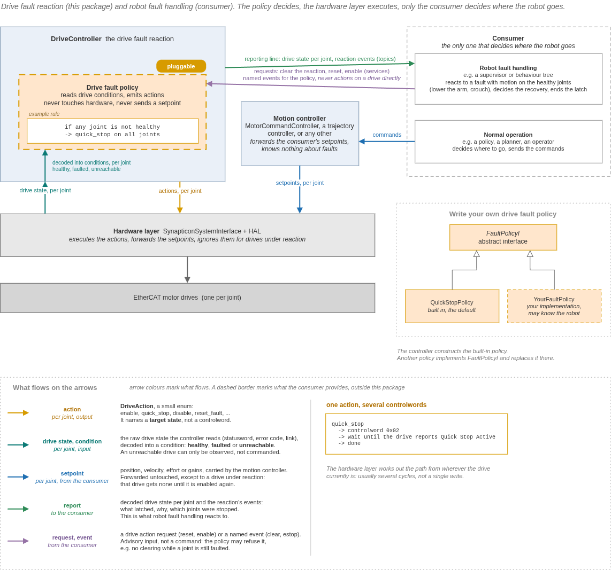

# Control layers and fault handling

How responsibilities are split between the consumer, the controllers and the hardware layer of this
package, and how a drive fault is handled across them. Read this before adding behaviour anywhere in the
stack, so that it lands in the layer it belongs to.

## The driving school example

A driving lesson. The student decides where to go and drives. The student's hands and feet carry those
decisions to the car's controls, with no judgement of their own, and a reflex may override them on the
way, fast and without asking the head. The car does what its controls say.
The instructor sits beside the student with an extra brake pedal, watches with their own eyes and never
steers. When something goes wrong the instructor brakes, whatever the student does, and while the
instructor's brake is down the student's pedals do nothing. Getting the car going again is the student's
job: understand why the instructor braked, change the plan, and ask for the brake to be released.

| Layer | Who | In the driving school example | Job | Never does |
|---|---|---|---|---|
| Consumer | policy, planner, supervisor, operator, outside this package | the student | decide where to go and drive, and after a braking understand why, decide how to go on and ask for the brake to be released | command a drive directly |
| Motion controller | this package's command forwarder, a trajectory controller, or any other | the student's hands, feet and reflexes | carry the consumer's commands to the hardware every cycle, with small logic of its own such as holding the last setpoint, aborting a trajectory, or a reflex that overrides the command | higher-level planning |
| Hardware layer | the hardware interface, the HAL and the drives | the car | carry out drive actions, forward setpoints outside a fault reaction and ignore them during one | choose a setpoint |
| Drive fault reaction | the drive controller | the instructor with the extra brake pedal | watch the drives through its own view of their state, brake whatever the student does, latch | send a setpoint |

The last column is the one to check before writing code. If a change would make a layer do something in
that column, it is in the wrong layer.

> [!NOTE]
> The student and their hands and feet are two rows but not always two components. A consumer may put the
> decisions and the forwarding into one motion controller of their own, or split the forwarding into a
> chain of controllers. Everything between the head and the car is the student's body. The split in
> responsibilities is the same, it just lives in one piece of code or in several.

## Data flow

Two flows run side by side in every control cycle: motion and state.
Drive actions are a third kind of traffic, sent only on request.

**Motion.** The consumer publishes commands. A motion controller receives them and writes them to the
hardware interface's command interfaces. The hardware interface marshals them into the cyclic EtherCAT
frame. The drive follows them. Nothing on this path knows about faults.

**State.** The HAL reads each drive's state from the frame and the hardware interface
exposes it as state interfaces. Every controller that wants to see it claims what it needs, since state
interfaces are shared. The standard broadcasters publish joint positions, velocities and efforts for the
consumer. The drive controller decodes the drive state and publishes it for operators and for the
consumer's recovery logic.

**Drive actions.** Every CiA 402 drive runs a state machine in its firmware, with states such as Switch On
Disabled, Operation Enabled, Quick Stop Active and Fault. The drive follows setpoints only in Operation Enabled.
An action names a target state of that state machine, for example **quick stop, disable or enable**. The drive
controller requests it, the hardware layer works out the path from wherever the drive currently is and
walks it over several cycles. Actions and setpoints travel through different interfaces, and a drive
honours an action regardless of what setpoint it is being streamed at the time. That independence is
what the rest of this document builds on.

## The controllers

**Motion controllers** own the setpoint interfaces of the joints they drive, and nothing else. This
package ships one that forwards the consumer's command messages to the hardware, with a hold when no
fresh command arrives. A stock trajectory controller, which interpolates between waypoints and can
abort on a tolerance violation, or a plain forward controller, does the same job with more or less
logic in between. They are interchangeable: nothing else in this package needs to know which one is
active.

**The drive controller** owns the drive action interfaces of all joints, and nothing else. It has three
jobs: it offers services through which a consumer requests drive actions, it watches the state of every
drive and requests drive actions on its own when a drive fails, and it publishes decoded drive state.
How it decides when to act is the subject of the next section. It never writes a setpoint, so there is
nothing to reconcile between it and the motion controller.

**The bus monitor** watches the EtherCAT segment as a whole, link state and responding slaves, and
publishes that for diagnostics. Per-joint connectivity is part of each joint's state and is reported by
the drive controller instead.

## Fault handling

When a drive reports a fault or stops answering, two things happen, on the two sides of the line this
document draws. They are easy to confuse, so they get two names.

- The **drive fault reaction [low-level]** is this package's part. It acts on the drives themselves,
  through **drive actions**, not setpoints: quick stop, disable, enable. It can stop drives and release
  them, nothing else. It runs in the control cycle, right away, and it latches. It is not the recovery:
  it fixes nothing and decides nothing about how the robot carries on. It only makes sure that the
  first moment after a fault is a safe one. Example: the shoulder drive faults, so the whole arm is
  quick-stopped before the elbow and wrist carry on along a path that no longer makes sense.
  In the driving school example this is the brake pedal.
- **Robot fault handling [higher-level]** is the consumer's part: everything from the first reactive
  motion to being back in normal operation, **through setpoints** to the healthy drives and through
  **requests for drive actions** to the drive controller, which may refuse them. Example: the
  wrist drive faults and the shoulder and elbow lower the arm slowly to a resting pose. Or a leg drive
  fails, the robot crouches, signals that it is ready, has its drives re-enabled and gets up again.
  Where the reaction ends and the recovery begins is the consumer's call. This needs the robot model and
  the task. In the driving school example this is the steering.

The two fit the system in different places. Both may know the robot: a plugged-in drive fault reaction
policy can be as robot-specific as the consumer likes. What separates them is what they are allowed to do
and how fast they must do it.

- The **drive fault reaction** lives in this package, in the drive controller, inside the real-time loop.
  It must act within a control cycle, so it is kept small: conditions in, drive actions out, no motion.
- **Robot fault handling** is by design outside the real-time loop, in the consumer's module that sends
  the commands or in a supervisor. Deciding where a robot should move after a fault takes the robot model,
  the task and often more than one cycle. A plain motion controller knows nothing about faults and does
  not need to.

One hard boundary separates them: the drive fault reaction latches, and only the consumer ends the latch,
by clearing it and requesting reset and enable. Everything before that is motion on the healthy joints
while the latch holds, which the design allows. The two cooperate through configuration: a drive fault
reaction that wants to leave room for robot fault handling must not stop the joints the robot needs.
The drive fault reaction must never be the one that steers.

The rest of this document focusses on the drive fault reaction, the first of the two.

> [!NOTE]
> **Advanced: robot fault handling in the real-time loop.** A consumer can also decide to move part of
> robot fault handling into the RT loop: either as a custom motion controller that reads the drive
> fault reaction state, or as a chained controller downstream of the motion controller that passes
> setpoints through in normal operation and overrides them when a fault occurs.
> In the driving school example that is a reflex: fast, simple, acting before the head knows.
> In this document, we will not consider this, but it is possible to do that
> (such a chained controller then sits _after_ the motion controller, between it and the hardware layer).

### The drive fault reaction

The drive fault reaction is the immediate answer to a drive fault: it watches the drives,
decides which of them to stop or release, and leaves everything else to the consumer.
The diagram shows where it sits and what flows in and out of it.

The reaction runs inside the drive controller, every control cycle, in real time. It consumes the drive
state the controller already reads and produces drive actions. In between sits the drive fault policy.
Policy here means any implementation of the policy interface, e.g. a plain rule table today,
or any other implementation added by the consumer. It reads a per-joint condition (healthy, faulted or
unreachable) applies its rule, and emits per-joint actions. The policy decides, the hardware layer
executes. The policy never touches a drive itself, and the hardware layer never decides whether to react.

The built-in policy is deliberately simple and knows nothing about the robot: if any joint is faulted or
unreachable, quick stop all joints. A consumer may plug in a policy of their own, and that one may know
the robot as well as it likes. It may act on any drive in response to the state of any other: quick stop
the whole arm when the shoulder fails, disable only the failed joint and leave the rest to robot fault
handling, or escalate from quick stop to disable if a joint does not come to rest. What every policy has
in common is its reach: it requests drive actions, and it never sends a setpoint.

Three properties of the reaction are not negotiable:

- **It latches.** A rule that stops firing the moment the fault clears would silently hand the drives
  back to a motion controller that is still streaming. The reaction holds until it is explicitly
  cleared, also across a deactivation and activation of the drive controller.
- **It brakes, it does not steer.** The reaction chooses which action to request on which joints.
  It never chooses a setpoint, so it never competes with the motion controller and never has to know
  which one is active.
- **It is a soft safety layer.** The instructor looks through the same windscreen as the student: the
  reaction's view of the drives comes from the same frames that carry the setpoints. A certified safety
  function, where one is required, is a second set of eyes and brakes built into the drives, and comes
  on top of this.

An optional external supervisor may feed the policy named events, for example a request to clear or an
emergency stop. Events are advisory. The policy may refuse one, for example a clear while a joint is
still faulted. A supervisor can ask for a transition, it cannot command a drive. That keeps exactly one
decider in the design.

## What the hardware layer does during a reaction

The hardware layer forwards what the motion controller writes, with one exception and one special case.

**The exception.** A drive under fault reaction gets no controller setpoints. From the moment a stop
action is requested for a drive, or the drive reports a fault, the hardware layer stops forwarding the
motion controller's setpoints to that drive. The cyclic frame still carries a target, because every frame
does, but it is the last one the drive received, and a stopped or de-energised drive ignores it. The
motion controller may keep streaming the whole time. Forwarding resumes only when the drive is
re-enabled, which happens after the reaction has been cleared. The first setpoint that reaches the drive
is therefore the one the consumer chose for the recovery.

**The special case.** In exactly one situation the hardware layer sends a setpoint of its own: when a
drive action needs one to achieve its documented behaviour, because the drive does not do the whole job
by itself. The example is a quick stop in a torque-type mode, where the drive keeps running its control
law on the streamed target and only a frozen target brings the joint to a stop. Such a hold replaces an
ignored controller setpoint. It never competes with one, and it is never a judgement about the setpoint.

Apart from this hold, every setpoint the hardware layer sends comes from a controller.

## Recovery

Recovery is the part of robot fault handling that touches this package: ending the latch and bringing
the drives back. It typically needs knowledge of the robot, the task and what a sensible next setpoint is.

A drive fault reaction fires in real time and latches. While it is latched, the hardware layer
ignores every setpoint the motion controller streams to the affected drives. The recovery sees the
event, decides a strategy, re-commands the motion controller with whatever setpoint it chooses, then
clears the reaction and requests reset and enable. Only then does the hardware layer listen to
external setpoints again. If the drive faults again, the reaction fires again and the recovery retries
or escalates, which means that the recovery strategy was not adequate.
Neither the hardware layer nor the drive fault reaction judges the setpoint.
Only the recovery strategy does, and the recovery belongs to the consumer.

The package supports recovery with two things and no more: a reporting line, meaning the drive
controller's published drive state and reaction events, and the services through which drive actions
are requested.

## Where does my change belong?

- **Behaviour the drive standard defines, and the path to a drive state:** the hardware layer.
  Mode- and vendor-specific details live below the HAL abstraction, never in a controller.
- **Which drives to stop when a drive faults:** the drive fault reaction policy. Conditions in, actions out.
- **Where the robot should go next, including after a fault:** the consumer. Robot fault handling,
  reaction and recovery alike, is theirs.
- **Something that needs to know which motion controller is active:** probably in the wrong place.
  The design is built so that nothing in this package needs to know.
- **A setpoint originating in the hardware layer:** only to make a drive action achieve its documented
  behaviour. Anything else is a controller's job.
- **A setpoint originating in the drive fault reaction:** never.
- **A judgement about a setpoint, in the hardware layer or the reaction:** never. Judging setpoints
  is recovery, and recovery is the consumer's.
